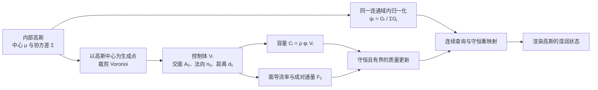

# Gaussian Wetting

这是一个面向多孔材料吸水传播与高斯渲染的研究原型。当前主方案采用 **高斯 + 裁剪 Voronoi** 混合结构：高斯负责连续材料表示、节点参数和渲染查询，Voronoi 控制体负责物理体积、公共交面和局部守恒。这样可以保留高斯对渲染和连续查询的适配能力，同时为有限体积输运提供明确的几何边界。

完整的方法、变量定义与数据流见 [高斯-Voronoi 混合守恒输运方案](高斯-Voronoi混合守恒输运方案.md)，实现说明见 [gaussian_transport/README.md](gaussian_transport/README.md)。

## 方法概览



对物理节点 `i`，孔隙水容量为 `C_i = ρ_w φ_i V_i`，饱和度为 `S_i = m_i/C_i`。两个相邻控制体只通过共享交面交换质量；同一条边在两端使用大小相同、符号相反的通量，因此内部交换不会改变总水量。高斯协方差描述节点的空间影响范围，但主路线不直接把椭球积分当作控制体体积。

## 目录

| 路径 | 内容 |
|---|---|
| `高斯-Voronoi混合守恒输运方案.md` | 主方案、关键变量、输运与渲染查询流程 |
| `stage_m2_partition/` | 高斯核、单位分解 `ψ_i`、积分和容量计算；也是混合原型的运行依赖 |
| `gaussian_transport/` | 裁剪 Voronoi、图输运、平滑高斯候选、守恒重映射与验证 |
| `stage_a_internal/` | 早期内部高斯与代表体积原型 |
| `stage_b_transport/` | 早期守恒输运与表面供水原型 |

`gaussian_transport/geometry.py` 实现二维裁剪 Voronoi，以及用于小规模参考验证的三维盒域版本；`transport.py` 实现容量、毛细势、渗透率、重力和有界质量交换；`remap.py` 用高斯单位分解在节点拆分或合并后守恒转移质量；`smooth_faces.py` 保留纯平滑高斯有效面的研究候选。

## 安装

建议使用 Python 3.9 或更新版本。核心代码只依赖 NumPy。

```bash
git clone https://github.com/lixiangnew/Gaussian-Wetting.git
cd Gaussian-Wetting
python -m venv .venv
python -m pip install -r requirements.txt
```

Windows PowerShell 可用 `.\.venv\Scripts\Activate.ps1` 激活环境；Linux/macOS 使用 `source .venv/bin/activate`。

## 测试与运行

以下命令均从仓库根目录执行：

```bash
python -B -m unittest discover -s stage_m2_partition -p test_partition.py -v
python -B -m unittest gaussian_transport.test_pipeline -v
python -B -m gaussian_transport.run_all
```

高斯体积分区的完整实验和绘图可分别运行；绘图脚本额外需要 Matplotlib：

```bash
python -B stage_m2_partition/run_experiments.py
python -B stage_m2_partition/plot_results.py
```

`gaussian_transport.run_all` 将 JSON/CSV 写入 `gaussian_transport/outputs/`。已有输出用于复核本次原型运行；重复执行会覆盖同名文件。

## 当前范围

已实现的主线是已知二维盒域或由凸块组成的 L 形域上的裁剪 Voronoi，以及小规模三维盒域参考实现。代码检查控制体总体积、边界测度、成对守恒、容量约束、时间/空间收敛和节点拆分/合并后的质量守恒。

平滑高斯有效面属于研究候选，目前不能替代主路线的显式 Voronoi 交面。任意非正交网格上的强各向异性输运也需要多点通量或梯度重构，不能把两点通量结果直接推广。真实材料参数标定、原型 FVM 接口、自由液体双向耦合和完整湿润渲染仍需在目标原型上验证。
