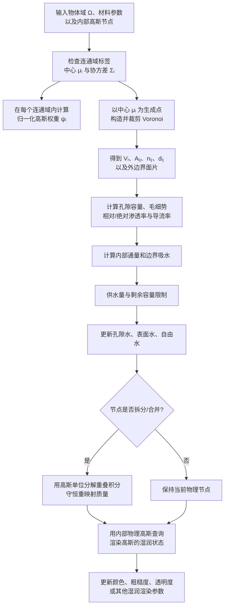

# 高斯 + Voronoi 混合守恒输运方案

## 1. 方案目标

本方案用两套相互配合的表示完成湿润模拟：

- **内部物理高斯**描述材料节点的位置、方向、尺度和连续影响范围，并承担参数查询、状态重映射以及向渲染高斯传递湿润状态的任务。
- **裁剪 Voronoi 控制体**给每个物理高斯分配互不重叠的体积，并给相邻节点提供明确的公共交面。有限体积输运在这些控制体上计算，以保证局部和全局质量守恒。

它不是把一个高斯椭球直接当作有限体积单元。高斯具有无限支撑并相互重叠，单独积分每个高斯会重复计算材料体积；Voronoi 则能把物体域严格划分为不重叠区域。因此，主路线让高斯负责连续表示，让 Voronoi 负责守恒几何。

## 2. 总体流程



## 3. 内部物理高斯

第 `i` 个内部高斯由中心 `μ_i`、对称正定协方差 `Σ_i` 和连通域标签 `c_i` 定义：

```text
G_i(x) = exp[-1/2 (x-μ_i)^T Σ_i^(-1) (x-μ_i)]
```

- `μ_i` 是物理节点和 Voronoi 生成点的位置。
- `Σ_i` 的特征向量给出主方向，特征值的平方根给出各方向的影响尺度。
- `c_i` 防止隔着空气间隙或不连通材料错误归一化和传水。

在同一连通域内，将高斯归一化为单位分解：

```text
ψ_i(x) = G_i(x) / Σ_{j:c_j=c_i} G_j(x)
Σ_i ψ_i(x) = 1
```

计算时先减去最小马氏距离再指数化，避免离节点很远时所有核同时数值下溢。`ψ_i` 用于连续参数查询、渲染查询和拓扑变化后的质量重映射；主输运容量则使用 Voronoi 体积。

## 4. Voronoi 守恒几何

以高斯中心为生成点，第 `i` 个控制体为：

```text
Ω_i = Ω ∩ {x : ||x-μ_i|| ≤ ||x-μ_j||, 对所有同域节点 j}
V_i = |Ω_i|
```

二维实现从物体的凸多边形块出发，依次用节点对的垂直平分线半空间裁剪。若物体是规则矩形且高斯中心规则排列，所得控制体会退化为熟悉的小矩形；对于扰动节点、边界节点和 L 形区域，控制体会成为被物体边界裁剪的不规则多边形。

相邻控制体 `i`、`j` 的公共交面给出：

- `A_ij`：公共交面的面积；二维乘厚度后由共享线段长度得到。
- `n_ij`：从节点 `i` 指向节点 `j` 的单位法向量。
- `d_ij = ||μ_j-μ_i||`：两个生成点的中心距离。
- `x_ij`：公共交面的几何中心。

`A_ij` 不是人工指定的小方块表面积，而是实际裁剪后两个 Voronoi 区域的公共边界测度。代码还记录外边界面片的所属节点、面积、外法向和中心，用于供水或边界通量。

## 5. 容量与材料变量

主要变量如下：

| 变量 | 定义 | 作用 |
|---|---|---|
| `V_i` | 第 `i` 个 Voronoi 控制体体积 | 固体代表体积 |
| `φ_i` | 孔隙率，取值 `[0,1]` | 控制可储水孔隙体积 |
| `ρ_w` | 水密度 | 将水体积换成质量 |
| `C_i = ρ_w φ_i V_i` | 最大孔隙水质量 | 饱和度上界 |
| `m_i` | 当前孔隙水质量 | 守恒更新的主未知量 |
| `S_i = m_i/C_i` | 饱和度 | 材料响应和渲染状态 |
| `K_i` | 绝对渗透率标量或张量 | 材料骨架本身的导水能力 |
| `k_r(S_i)` | 相对渗透率 | 含水状态对导水能力的折减 |
| `p_c(S_i)` | 毛细压力 | 产生由干向湿的吸水势差 |

绝对渗透率由材料结构决定，单位通常为 `m²`；相对渗透率是无量纲函数，表示在当前饱和度下还能发挥多少绝对渗透能力。两者相乘形成状态相关的有效渗透能力。本原型支持线性响应和 van Genuchten 型响应，具体材料仍需用实验参数标定。

## 6. 面导流率与守恒通量

先把渗透率张量投影到交面法向：

```text
k_{n,i} = n_ij^T K_i n_ij
k_{n,j} = n_ij^T K_j n_ij
k_{n,ij} = 2 k_{n,i} k_{n,j} / (k_{n,i}+k_{n,j})
```

谐均值能避免低渗透一侧被高渗透一侧掩盖。几何和材料共同给出面导流系数：

```text
T_ij = (ρ_w/μ_w) (A_ij/d_ij) k_{n,ij}
```

其中 `μ_w` 是动力黏度。节点水势可写为毛细项和重力项的组合：

```text
H_i = -p_c(S_i) - ρ_w μ_i·g
```

当前两点通量形式为：

```text
F_ij = T_ij · [k_r(S_i)+k_r(S_j)]/2 · (H_i-H_j)
F_ji = -F_ij
```

每条内部边只计算一次通量，一端减去的质量同时加到另一端，所以内部交换严格成对守恒。时间步更新还会按供水节点的现有质量和接收节点的剩余容量统一缩放，保证：

```text
0 ≤ m_i ≤ C_i
```

自由水、表面水和孔隙水分别记账。外部供水先进入边界表面库，再根据边界水头和内部水势进入孔隙；整个更新向量采用同一套供体/受体限制器。

对于明显非正交的控制体或一般各向异性张量，`μ_j-μ_i` 与真实通量方向可能不一致。此时两点通量不够准确，需要多点通量或梯度重构；当前实现把它作为明确限制，而不是把等方性结果直接推广。

## 7. 节点拆分与合并后的守恒重映射

高斯数量变化时，不能把旧饱和度直接复制给新节点，否则新旧控制体容量不同会制造或丢失水。方案用旧、新两组归一化高斯的重叠积分建立转移矩阵：

```text
J_{ji} = ∫_Ω ψ_j^new(x) ψ_i^old(x) dx
R_{ji} = J_{ji} / ∫_Ω ψ_i^old(x) dx
m_j^new = Σ_i R_{ji} m_i^old
```

对每个旧节点，转移权重之和为 1，因此新质量总和等于旧质量总和。重映射后仍要检查新控制体容量；若发生超容，应通过更合适的局部再分配或减小拓扑变化幅度解决。

## 8. 从内部物理高斯查询渲染高斯

渲染高斯与物理控制体不必一一对应。对渲染高斯中心 `x_r`，先只选择同一材料或连通域内的附近物理高斯，再计算带代表体积的查询权重：

```text
q_{ri} = V_i G_i(x_r)
w_{ri} = q_{ri} / Σ_j q_{rj}
```

体积因子避免密集区域仅因节点更多而获得过大权重。孔隙率和含水量建议分别查询：

```text
φ_r = Σ_i w_{ri} φ_i
θ_r = Σ_i w_{ri} φ_i S_i
S_r = θ_r / max(φ_r, ε)
```

其中 `θ=φS` 是体积含水率。先插值 `φ` 和 `θ` 再求 `S`，比直接平均饱和度更适合孔隙率不均匀的材料。随后可将 `S_r` 或 `θ_r` 映射到渲染高斯的颜色、粗糙度、透明度、法线扰动或其他湿润外观参数。协方差还可用于各向异性近邻搜索和方向一致的平滑查询。

## 9. 平滑高斯有效面候选

代码保留了一条纯平滑候选路线，通过单位分解梯度积分构造节点对的有效面积向量：

```text
A⃗_ij = ∫_Ω [ψ_i ∇ψ_j - ψ_j ∇ψ_i] dx
```

它具有反对称结构，可用于研究无显式 Voronoi 网格的守恒离散。不过，将面积向量投影到节点连线并直接放入两点 Darcy 通量，会丢失横向分量；几何闭合成立也不代表线性场通量准确。因此当前主路线仍使用显式裁剪 Voronoi，这条路线只作为后续多点通量或无网格离散研究入口。

## 10. 方案优势与验证边界

混合结构的主要优势是职责清晰：Voronoi 提供唯一的体积和公共交面，高斯提供连续查询、方向尺度、拓扑重映射以及与高斯渲染的自然接口。相比纯 Voronoi，渲染和跨分辨率查询更自然；相比纯高斯，体积不会因核重叠而重复计算，邻接和守恒通量也更明确。

当前代码是 NumPy 研究原型，已经覆盖二维裁剪、小规模三维盒域参考、成对守恒输运和高斯重映射。它尚未完成真实原型 FVM 接口对齐、复杂三维曲面的大规模稳健裁剪、材料参数反演、自由液体双向耦合以及湿润渲染闭环。这些内容需要拿到目标原型代码和三个可控实验场景后再做最终验证。
